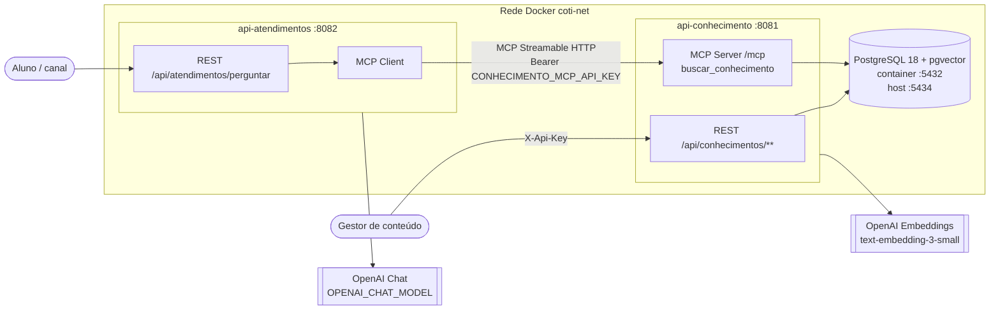
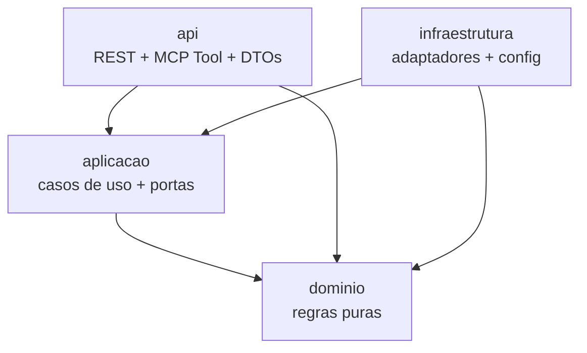
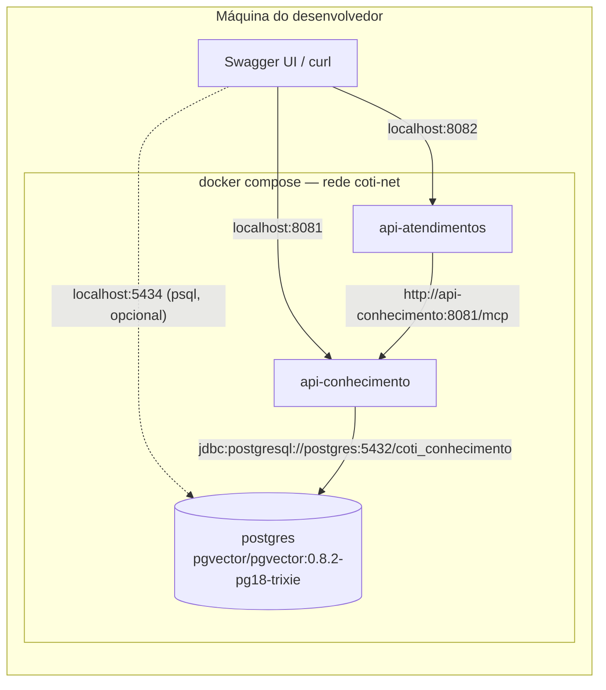
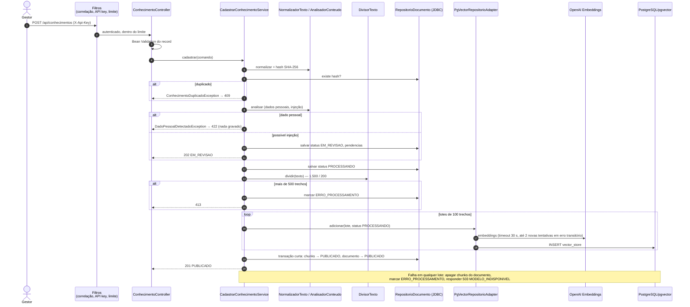
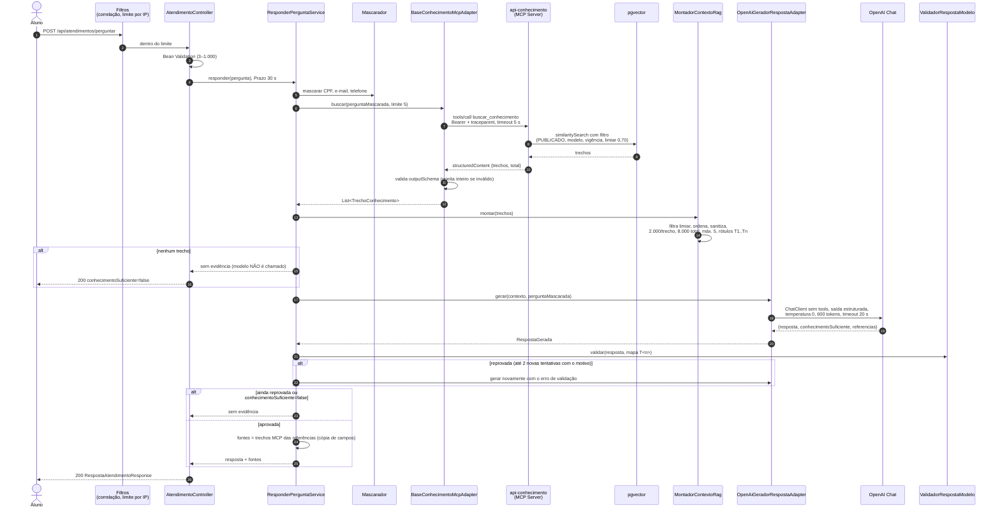
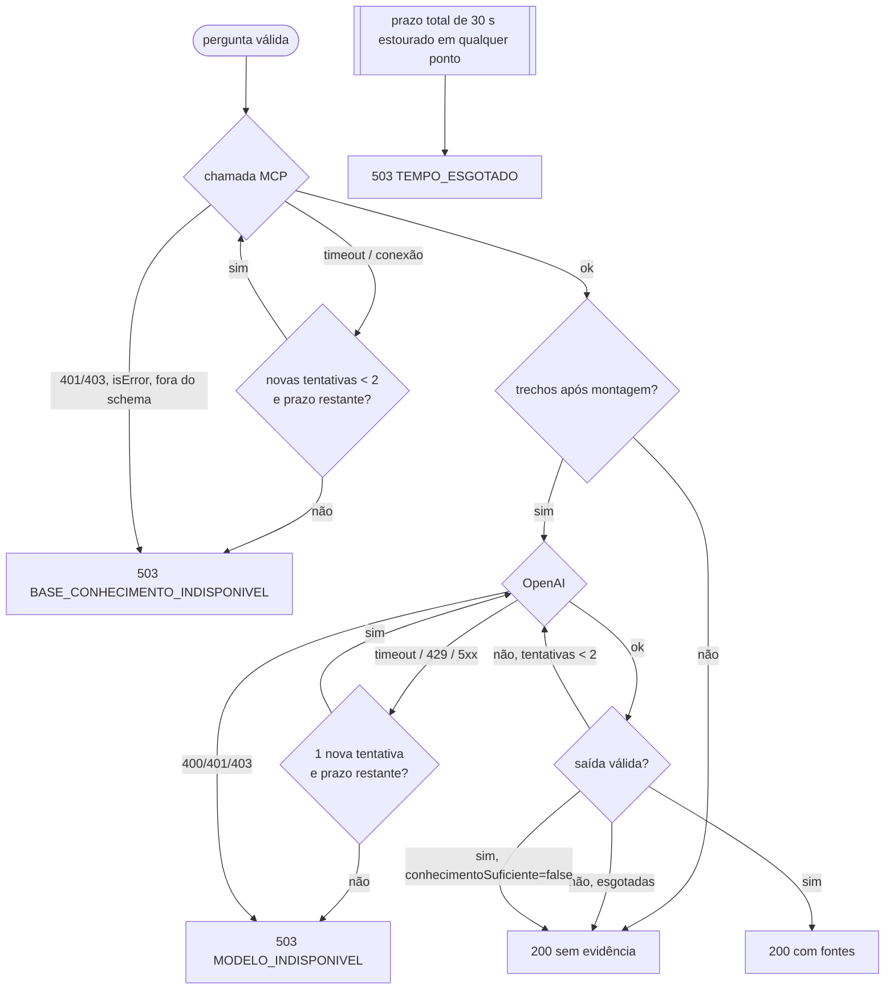

# Arquitetura do MVP — COTI AI Atendimento

Este documento fixa a arquitetura do MVP. Ele obedece a [`01-constitution.md`](01-constitution.md), implementa [`02-requirements.md`](02-requirements.md) e respeita [`06-api-contracts.md`](06-api-contracts.md). As decisões estão na seção 12 (ADRs); cada uma diz qual alternativa foi descartada e por quê.

Itens marcados **(conferir)** dependem de detalhe de biblioteca ainda não confirmado na documentação oficial da versão fixada e devem ser verificados na primeira tarefa que os usar.

---

## 1. Visão geral

O MVP é um **workflow RAG com passos fixos em código**, não um agente. Na escala de complexidade (chamada simples → RAG → workflow → agente), ficamos em **RAG orquestrado por workflow**: uma chamada simples ao modelo não basta porque a resposta precisa vir de documentos da COTI, e um agente que decide os próprios passos é desnecessário, porque o caminho é sempre o mesmo (buscar → montar contexto → responder → validar).



| Serviço | Porta | Dados próprios | Fala com |
|---|---|---|---|
| `api-conhecimento` | 8081 | PostgreSQL/pgvector | OpenAI Embeddings |
| `api-atendimentos` | 8082 | Nenhum | `api-conhecimento` (só MCP), OpenAI Chat |
| `postgres` | 5434 no host → 5432 no container | — | — |

---

## 2. Stack e versões

| Item | Versão | Observação |
|---|---|---|
| Java | 21 (LTS) | Virtual threads habilitadas (`spring.threads.virtual.enabled=true`) |
| Spring Boot | **4.1.x** | Spring AI 2.0 suporta 4.0.x e 4.1.x; 4.1 alinha com springdoc 3.1. Patch exato fixado em `04-plan.md` **(conferir** na nota de lançamento do Spring AI 2.0.1) |
| Spring AI | **2.0.1** | Via `spring-ai-bom` |
| PostgreSQL | **18** | Imagem `pgvector/pgvector:0.8.2-pg18-trixie` **(conferir** tag no Docker Hub). Se o PostgreSQL 19 já estiver GA, o 18 continua sendo a escolha conservadora do MVP |
| pgvector | 0.8.2 | Fixado pela tag da imagem |
| Maven | 3.9.x via Maven Wrapper | `./mvnw` na raiz |
| Flyway | linha compatível com Boot 4.1 | Dependência gerenciada pelo Boot; aprovada em 2026-10-22 |
| springdoc-openapi | 3.x (compatível com Boot 4.1) | Aprovada em 2026-10-22 |
| Testcontainers | gerenciado pelo Boot | Aprovada em 2026-10-22 (pacotes 2.x — conferir) |
| ArchUnit, WireMock | versões estáveis atuais | Aprovadas em 2026-10-22 |

Dependências detalhadas na seção 13.

---

## 3. Estrutura do monorepo

Repositório único com **dois projetos Spring Boot independentes**. A raiz é só um **agregador Maven** (`packaging pom`, seção `<modules>`): não é parent dos serviços e não contém código. Cada serviço tem como parent o `spring-boot-starter-parent` e importa o `spring-ai-bom`, de modo que pode ser extraído para outro repositório sem mudança.

```text
coti-ai-atendimento/
├── pom.xml                         # agregador: <modules> api-conhecimento, api-atendimentos
├── mvnw, mvnw.cmd, .mvn/
├── docker-compose.yml              # postgres, api-conhecimento, api-atendimentos
├── .env.example                    # nomes das variáveis, sem valores
├── .gitignore                      # inclui .env
├── AGENTS.md
├── README.md
├── docker/
│   └── postgres/
│       └── init/
│           └── 01-roles.sql        # cria papéis coti_owner e coti_app (senhas vindas do ambiente)
├── specs/
│   ├── 01-constitution.md … 08-checklist.md
├── skills/
│   └── spring-ai/ mcp-integration/ rag-pgvector/ testing/
│
├── api-conhecimento/
│   ├── pom.xml                     # parent: spring-boot-starter-parent; import spring-ai-bom
│   ├── Dockerfile                  # multi-stage, usuário não root
│   ├── eval/
│   │   └── recuperacao.jsonl       # eval de recuperação (top-k)
│   └── src/
│       ├── main/
│       │   ├── java/br/com/coti/conhecimento/
│       │   │   ├── ApiConhecimentoApplication.java
│       │   │   ├── api/                       # "controller": traduz HTTP e MCP
│       │   │   │   ├── rest/                  # ConhecimentoController, DiagnosticoBuscaController
│       │   │   │   │   └── dto/               # records: CadastrarConhecimentoRequest, ...Response
│       │   │   │   ├── mcp/                   # BuscarConhecimentoTool (@McpTool), records ResultadoBusca, TrechoResultado
│       │   │   │   └── erro/                  # ManipuladorErrosRest (ProblemDetail), CodigoErro
│       │   │   ├── aplicacao/                 # "application/service": casos de uso e portas
│       │   │   │   ├── CadastrarConhecimentoService.java
│       │   │   │   ├── ConsultarConhecimentosService.java
│       │   │   │   ├── BuscarConhecimentoService.java
│       │   │   │   └── porta/                 # RepositorioDocumentoPort, RepositorioVetorialPort,
│       │   │   │                              # AnalisadorConteudoPort, RelogioPort (se necessário)
│       │   │   ├── dominio/                   # "domain/model": sem Spring, sem Spring AI
│       │   │   │   ├── Documento.java, StatusDocumento.java, Categoria.java, Pendencia.java
│       │   │   │   ├── Trecho.java, TrechoEncontrado.java
│       │   │   │   ├── DivisorTexto.java      # divisão com sobreposição (RF02)
│       │   │   │   ├── NormalizadorTexto.java
│       │   │   │   └── excecao/               # ConhecimentoDuplicadoException, DadoPessoalDetectadoException, ...
│       │   │   └── infraestrutura/            # "infrastructure/config": adaptadores e configuração
│       │   │       ├── persistencia/          # DocumentoJdbcRepositorio (JdbcClient)
│       │   │       ├── vetorial/              # PgVectorRepositorioAdapter (VectorStore)
│       │   │       ├── analise/               # AnalisadorConteudoRegex (injeção, dados pessoais)
│       │   │       ├── seguranca/             # ApiKeyAuthFilter, SecurityConfig, LimiteRequisicoesFilter
│       │   │       ├── observabilidade/       # CorrelacaoFilter, mascaramento de log
│       │   │       └── config/                # @ConfigurationProperties (records), OpenApiConfig, beans
│       │   └── resources/
│       │       ├── application.yml
│       │       ├── application-local.yml
│       │       └── db/migration/              # V1__extensoes.sql, V2__documento.sql, V3__vector_store.sql
│       └── test/
│           └── java/br/com/coti/conhecimento/
│               ├── dominio/                   # unitários: DivisorTexto, Normalizador
│               ├── aplicacao/                 # unitários com dublês das portas
│               ├── api/                       # @WebMvcTest, contrato REST
│               ├── integracao/                # *IT: Testcontainers pgvector, MCP real
│               └── arquitetura/               # ArchUnit
│
└── api-atendimentos/
    ├── pom.xml
    ├── Dockerfile
    ├── eval/
    │   ├── resposta.jsonl
    │   └── adversarial.jsonl
    └── src/
        ├── main/
        │   ├── java/br/com/coti/atendimentos/
        │   │   ├── ApiAtendimentosApplication.java
        │   │   ├── api/
        │   │   │   ├── rest/                  # AtendimentoController
        │   │   │   │   └── dto/               # PerguntarRequest, RespostaAtendimentoResponse, FonteResponse
        │   │   │   └── erro/                  # ManipuladorErrosRest, CodigoErro
        │   │   ├── aplicacao/
        │   │   │   ├── ResponderPerguntaService.java     # orquestra o workflow (fluxo B)
        │   │   │   ├── MontadorContextoRag.java          # filtro, sanitização, limites, rótulos T<n>
        │   │   │   ├── ValidadorRespostaModelo.java      # referências, evidência de valores/datas
        │   │   │   └── porta/                 # BaseConhecimentoPort, GeradorRespostaPort, MascaradorPort
        │   │   ├── dominio/
        │   │   │   ├── PerguntaAluno.java, TrechoConhecimento.java, ContextoRag.java
        │   │   │   ├── RespostaGerada.java, Fonte.java, ResultadoAtendimento.java
        │   │   │   ├── Prazo.java             # orçamento de tempo do atendimento (30 s)
        │   │   │   └── excecao/               # BaseConhecimentoIndisponivelException, ModeloIndisponivelException, TempoEsgotadoException
        │   │   └── infraestrutura/
        │   │       ├── mcp/                   # BaseConhecimentoMcpAdapter, McpCabecalhosCustomizer, ConhecimentoMcpHealthIndicator
        │   │       ├── ia/                    # OpenAiGeradorRespostaAdapter (ChatClient), RespostaModelo (record)
        │   │       ├── privacidade/           # MascaradorDadosPessoaisRegex
        │   │       ├── seguranca/             # SecurityConfig, LimiteRequisicoesFilter
        │   │       ├── observabilidade/       # CorrelacaoFilter
        │   │       └── config/                # @ConfigurationProperties, OpenApiConfig
        │   └── resources/
        │       ├── application.yml
        │       ├── application-local.yml
        │       └── prompts/
        │           ├── responder-pergunta.system.v1.st
        │           └── responder-pergunta.user.v1.st
        └── test/
            └── java/br/com/coti/atendimentos/
                ├── aplicacao/                 # Montador, Validador, ResponderPergunta (dublês)
                ├── api/                       # @WebMvcTest, contrato REST, health
                ├── integracao/                # *IT: servidor MCP de teste, OpenAI falsa (WireMock)
                └── arquitetura/
```

### 3.1 Camadas

A constituição (Artigo 3) nomeia as camadas em português. A tabela mostra a correspondência com a nomenclatura usual:

| Pacote | Equivale a | Conteúdo | Pode depender de |
|---|---|---|---|
| `api` | controller | Controllers REST, ferramenta MCP, DTOs (`record`), tratamento de erro | `aplicacao`, `dominio` |
| `aplicacao` | application / service | Casos de uso, orquestração, **portas** (interfaces) | `dominio` |
| `dominio` | domain / model | Entidades, objetos de valor, regras puras, exceções de domínio | nada (só JDK) |
| `infraestrutura` | infrastructure / config | Adaptadores das portas (JDBC, VectorStore, MCP Client, ChatClient), segurança, configuração | `aplicacao`, `dominio`, frameworks |



- O domínio não importa Spring, Spring AI, JDBC, MCP nem Jackson.
- O `DivisorTexto` e o `MontadorContextoRag` são código puro: o primeiro no domínio, o segundo na aplicação (ele conhece o formato do prompt, que é decisão da aplicação, mas não conhece Spring AI).
- Um teste ArchUnit por serviço garante essas regras.

---

## 4. Infraestrutura local (Docker)



| Serviço compose | Imagem | Porta no host | Observações |
|---|---|---|---|
| `postgres` | `pgvector/pgvector:0.8.2-pg18-trixie` | `127.0.0.1:5434` → 5432 | Volume nomeado; `healthcheck` com `pg_isready`; senhas via `.env` |
| `api-conhecimento` | build local | `127.0.0.1:8081` | `depends_on: postgres (healthy)` |
| `api-atendimentos` | build local | `127.0.0.1:8082` | Não depende de saúde da `api-conhecimento` (sobe mesmo sem ela — RNF07) |

- Portas ligadas a `127.0.0.1`, não a `0.0.0.0`: nada fica acessível pela rede local da máquina.
- Para desenvolver no IDE, só o `postgres` sobe no compose e as APIs rodam com o perfil `local` (`CONHECIMENTO_DB_URL=jdbc:postgresql://localhost:5434/coti_conhecimento`, `CONHECIMENTO_MCP_URL=http://localhost:8081`).
- Testes de integração não usam o compose: usam Testcontainers com a mesma imagem.

### 4.1 Banco de dados

- Banco `coti_conhecimento`, dois papéis:
  - `coti_owner`: dono do schema, usado **só pelo Flyway**;
  - `coti_app`: usado pela aplicação, com `SELECT, INSERT, UPDATE, DELETE` nas tabelas, sem DDL.
- Migrações Flyway em `api-conhecimento/src/main/resources/db/migration`:
  - `V1__extensoes.sql`: `vector`, `hstore`, `uuid-ossp` (exigidas pelo `PgVectorStore`, conforme a documentação do Spring AI 2.0);
  - `V2__documento.sql`: tabela `documento`;
  - `V3__vector_store.sql`: tabela `vector_store` (`id uuid`, `content text`, `metadata json`, `embedding vector(1536)`) e índice `HNSW (embedding vector_cosine_ops)`.
- `spring.ai.vectorstore.pgvector.initialize-schema=false` e `schema-validation=true`.

Tabela `documento`:

| Coluna | Tipo | Regra |
|---|---|---|
| `id` | `uuid` PK | |
| `titulo` | `varchar(200)` | not null |
| `conteudo` | `text` | not null; texto normalizado (permite reindexar) |
| `fonte` | `varchar(300)` | not null |
| `categoria` | `varchar(20)` | not null, `CHECK` com os valores do enum |
| `status` | `varchar(20)` | not null, `CHECK` (`PROCESSANDO`, `PUBLICADO`, `EM_REVISAO`, `ERRO_PROCESSAMENTO`) |
| `pendencias` | `varchar(40)[]` | pode ser vazio |
| `hash_conteudo` | `char(64)` | not null, **unique** (SHA-256) |
| `quantidade_chunks` | `integer` | not null, default 0 |
| `modelo_embedding` | `varchar(100)` | not null |
| `vigente_ate` | `date` | nullable |
| `cadastrado_por` | `varchar(100)` | not null (identificador da credencial) |
| `cadastrado_em` | `timestamptz` | not null |

`PROCESSANDO` é um status **interno** (dura só durante o cadastro; ver ADR-07). O contrato público expõe `PUBLICADO`, `EM_REVISAO` e `ERRO_PROCESSAMENTO`; se um registro for lido enquanto `PROCESSANDO`, a API o apresenta como `ERRO_PROCESSAMENTO` caso o processo tenha sido interrompido (limpeza na subida, seção 6.4).

Metadados JSON de cada linha de `vector_store`:

| Chave | Tipo | Exemplo |
|---|---|---|
| `documentoId` | string (UUID) | `"3f6c…"` |
| `titulo`, `fonte` | string | |
| `categoria` | string | `"PRE_REQUISITO"` |
| `ordem` | inteiro | `0` |
| `status` | string | `"PROCESSANDO"` → `"PUBLICADO"` |
| `modeloEmbedding` | string | `"text-embedding-3-small"` |
| `vigenteAte` | inteiro `AAAAMMDD` | `20270630`; **`99991231` quando não há vigência** (ADR-08) |
| `cadastradoEm` | string ISO-8601 | |

---

## 5. Configuração

Toda credencial e endereço vêm de variável de ambiente (Artigo 7). Valores não secretos têm padrão no `application.yml`.

### 5.1 Variáveis de ambiente

| Variável | Serviço | Obrigatória | Padrão |
|---|---|---|---|
| `OPENAI_API_KEY` | ambos | Sim | — |
| `OPENAI_CHAT_MODEL` | atendimentos | Sim | — (sem padrão: identificador com versão, escolhido pelo eval; ADR-15) |
| `OPENAI_EMBEDDING_MODEL` | conhecimento | Não | `text-embedding-3-small` |
| `OPENAI_EMBEDDING_DIMENSIONS` | conhecimento | Não | `1536` |
| `CONHECIMENTO_DB_URL` | conhecimento | Sim | — |
| `CONHECIMENTO_DB_USER`, `CONHECIMENTO_DB_PASSWORD` | conhecimento | Sim | — (papel `coti_app`) |
| `CONHECIMENTO_FLYWAY_USER`, `CONHECIMENTO_FLYWAY_PASSWORD` | conhecimento | Sim | — (papel `coti_owner`) |
| `POSTGRES_PASSWORD` | compose | Sim | — (superusuário do container, só para o init) |
| `CONHECIMENTO_ADMIN_API_KEY` | conhecimento | Sim | — |
| `CONHECIMENTO_MCP_API_KEY` | ambos | Sim | — |
| `CONHECIMENTO_MCP_URL` | atendimentos | Sim | — |
| `MONITORAMENTO_API_KEY` | ambos | Sim | — (detalhes do health e métricas) |
| `CONHECIMENTO_MCP_TIMEOUT` | atendimentos | Não | `5s` |
| `OPENAI_TIMEOUT` | ambos | Não | conhecimento `30s`; atendimentos `20s` |
| `ATENDIMENTO_CANAL_HUMANO` | atendimentos | Sim | — |
| `ATENDIMENTO_MENSAGEM_SEM_EVIDENCIA` | atendimentos | Sim | — |

A aplicação **não sobe** sem as obrigatórias (validação de `@ConfigurationProperties` com `@Validated`), com mensagem que cita o nome da variável, nunca o valor.

### 5.2 Configuração principal — `api-conhecimento`

```yaml
server:
  port: 8081
spring:
  application.name: api-conhecimento
  threads.virtual.enabled: true
  datasource:
    url: ${CONHECIMENTO_DB_URL}
    username: ${CONHECIMENTO_DB_USER}
    password: ${CONHECIMENTO_DB_PASSWORD}
  flyway:
    user: ${CONHECIMENTO_FLYWAY_USER}
    password: ${CONHECIMENTO_FLYWAY_PASSWORD}
  ai:
    model.chat: none                    # este serviço não usa chat
    openai:
      api-key: ${OPENAI_API_KEY}
      timeout: ${OPENAI_TIMEOUT:30s}
      max-retries: 0                    # retry só na aplicação (ADR-13)
      embedding:
        model: ${OPENAI_EMBEDDING_MODEL:text-embedding-3-small}
        dimensions: ${OPENAI_EMBEDDING_DIMENSIONS:1536}
    vectorstore.pgvector:
      initialize-schema: false
      schema-validation: true
      index-type: HNSW
      distance-type: COSINE_DISTANCE
      dimensions: ${OPENAI_EMBEDDING_DIMENSIONS:1536}
    mcp.server:
      name: coti-conhecimento
      version: 1.0.0
      protocol: STREAMABLE
logging.structured.format.console: ecs
coti.conhecimento:
  divisao: { tamanho-maximo: 1500, sobreposicao: 200, tamanho-minimo: 50, maximo-trechos: 500 }
  embeddings: { tamanho-lote: 100, novas-tentativas: 2 }
  busca: { limite-padrao: 5, limite-maximo: 10, limiar-similaridade: 0.70, maximo-caracteres-trecho: 2000, maximo-caracteres-total: 8000, timeout-embedding-pergunta: 5s }
  limites-requisicao: { cadastro-por-minuto: 30, diagnostico-por-minuto: 10 }
```

### 5.3 Configuração principal — `api-atendimentos`

```yaml
server:
  port: 8082
spring:
  application.name: api-atendimentos
  threads.virtual.enabled: true
  ai:
    model.embedding: none               # Artigo 6: sem embedding aqui
    openai:
      api-key: ${OPENAI_API_KEY}
      timeout: ${OPENAI_TIMEOUT:20s}
      max-retries: 0
      chat:
        model: ${OPENAI_CHAT_MODEL}
        temperature: 0.0                # fidelidade ao trecho, sem criatividade
        max-tokens: 600                 # teto de custo por resposta
    mcp.client:
      name: coti-atendimentos
      type: SYNC
      request-timeout: ${CONHECIMENTO_MCP_TIMEOUT:5s}
      toolcallback.enabled: false       # o modelo não recebe ferramentas (ADR-06)
      streamable-http.connections.conhecimento:
        url: ${CONHECIMENTO_MCP_URL}
        endpoint: /mcp
logging.structured.format.console: ecs
coti.atendimentos:
  busca: { limite: 5, limiar-similaridade: 0.70 }
  contexto: { maximo-caracteres-trecho: 2000, maximo-caracteres-total: 8000, maximo-trechos: 5 }
  validacao: { novas-tentativas-saida: 2 }
  resiliencia: { mcp-novas-tentativas: 2, chat-novas-tentativas: 1, prazo-total: 30s, retry-after: 30s }
  prompt: { versao: v1 }
  mensagens:
    sem-evidencia: ${ATENDIMENTO_MENSAGEM_SEM_EVIDENCIA}
    canal-humano: ${ATENDIMENTO_CANAL_HUMANO}
  limites-requisicao: { perguntas-por-minuto-por-ip: 10 }
```

As chaves `coti.*` são da aplicação, lidas por `@ConfigurationProperties` em `record` com Bean Validation (por exemplo, `sobreposicao < tamanhoMaximo`). Nomes de propriedades do Spring AI conferidos na referência 2.0; `spring.ai.model.chat: none` segue o mesmo padrão documentado para `spring.ai.model.embedding` **(conferir)**.

---

## 6. Fluxo A — Ingestão

`POST /api/conhecimentos` → validação → análise → divisão → embeddings → pgvector → publicação. Requisitos RF01 a RF03.



### 6.1 Validação e análise

- Bean Validation no `CadastrarConhecimentoRequest` (`@NotBlank`, `@Size`, `@FutureOrPresent`, enum). Corpo acima de 256 KB é recusado antes da desserialização (limite do conector e filtro de tamanho). `spring.jackson` configurado para falhar em propriedade desconhecida.
- `NormalizadorTexto` (domínio): remove caracteres de controle, padroniza quebras de linha e espaços.
- `AnalisadorConteudoRegex` (infraestrutura): lista de padrões configurável. Dados pessoais: CPF (com dígito verificador), e-mail, telefone brasileiro. Injeção: "ignore as instruções", "desconsidere", "você agora é", "system prompt", marcações de papel (`system:`, `assistant:`), delimitadores do próprio prompt (`<trechos>`, `<pergunta>`). Detector é uma camada que falha; a defesa principal continua sendo o modelo sem privilégios (Artigo 10).

### 6.2 Divisão (`DivisorTexto`)

Algoritmo da skill `rag-pgvector` (seção 4): janela de 1.500 caracteres, sobreposição de 200, corte preferencial em parágrafo → frase → linha → espaço, garantia de avanço, mínimo de 50, máximo de 500 trechos. O `TokenTextSplitter` não é usado (não tem sobreposição; ADR-09). Id de cada chunk: UUID v5 (determinístico) de `documentoId + ":" + ordem`.

### 6.3 Embeddings e publicação sem estado parcial

1. O documento é gravado como `PROCESSANDO`.
2. Os chunks são gravados por `vectorStore.add(...)` em lotes de 100, com metadado `status = "PROCESSANDO"`. A busca filtra `status == 'PUBLICADO'`, então esses chunks são invisíveis.
3. Com todos os lotes gravados, **uma transação curta** faz:
   - `UPDATE vector_store SET metadata = jsonb_set(metadata::jsonb, '{status}', '"PUBLICADO"')::json WHERE metadata->>'documentoId' = :id` **(conferir** tipo `json` da coluna na versão);
   - `UPDATE documento SET status = 'PUBLICADO', quantidade_chunks = :n WHERE id = :id`.
4. Falha nos passos 2 ou 3: `vectorStore.delete(filtro documentoId == :id)` **(conferir** assinatura) e `documento.status = ERRO_PROCESSAMENTO`.

Assim, as chamadas à OpenAI ficam fora de transação de banco e a publicação é atômica (ADR-07).

### 6.4 Limpeza na subida

Um `ApplicationRunner` remove chunks com `status = PROCESSANDO` cujo documento esteja `PROCESSANDO` há mais de 10 minutos (processo interrompido) e marca esses documentos como `ERRO_PROCESSAMENTO`.

### 6.5 Diagrama de estados do documento

```mermaid
stateDiagram-v2
    [*] --> Rejeitado: dado pessoal (422) / duplicado (409)
    [*] --> EM_REVISAO: padrão de injeção (202)
    [*] --> PROCESSANDO: análise sem pendência
    PROCESSANDO --> PUBLICADO: todos os lotes gravados + transação de publicação
    PROCESSANDO --> ERRO_PROCESSAMENTO: falha de divisão, embedding ou gravação
    PUBLICADO --> [*]: remoção por script (fora do MVP por API)
    EM_REVISAO --> [*]: remoção por script; recadastro corrigido
    ERRO_PROCESSAMENTO --> [*]: remoção por script; recadastro
    Rejeitado --> [*]
```



---

## 7. Busca vetorial (RF04, RF05, RF12)

Um único caso de uso, `BuscarConhecimentoService`, atende a ferramenta MCP e o endpoint de diagnóstico.

1. Valida `pergunta` (3 a 1.000) e `limite` (1 a 10, padrão 5).
2. Gera o embedding da pergunta com timeout de 5 s (aplicado pela aplicação, pois o timeout do cliente OpenAI é único por serviço e está em 30 s para a ingestão).
3. `vectorStore.similaritySearch(SearchRequest.builder().query(...).topK(limite).similarityThreshold(0.70).filterExpression(filtro).build())`, com o filtro montado pelo `FilterExpressionBuilder`:
   - `status == 'PUBLICADO'`
   - `modeloEmbedding == '<modelo configurado>'`
   - `vigenteAte >= <hoje como AAAAMMDD>`
4. Converte `Document` → `TrechoEncontrado(id, texto, documentoId, titulo, fonte, categoria, similaridade)`; `similaridade = Document.getScore()` **(conferir** que, para `COSINE_DISTANCE`, o score já é `1 - distância`).
5. Ordena, corta cada texto em 2.000 e o total em 8.000 caracteres.

O filtro é traduzido pelo Spring AI para JSONPath do PostgreSQL. Com filtro e índice HNSW, o pgvector pode devolver menos que `k` resultados quando muitos vizinhos são filtrados; o pgvector 0.8 oferece varredura iterativa (`hnsw.iterative_scan`) para isso **(conferir** e medir no eval de recuperação antes de ligar).

---

## 8. Fluxo B — Atendimento

`POST /api/atendimentos/perguntar` → MCP → busca vetorial → evidências → prompt → OpenAI → resposta. Requisitos RF06 a RF10.

**A busca vetorial pela ferramenta MCP sempre acontece antes da geração da resposta, e é o código que a chama.** O `ResponderPerguntaService` invoca `buscar_conhecimento` de forma determinística em toda pergunta válida; o modelo de chat não recebe ferramentas e não decide se pesquisa (ADR-06).



### 8.1 Falhas no fluxo B



- O `Prazo` (objeto de domínio com o instante-limite) é passado por todo o fluxo; cada etapa usa `min(timeout próprio, tempo restante)` e não inicia nova tentativa sem tempo.
- Nenhuma falha produz resposta parcial ou inventada.

---

## 9. Contratos de integração internos

| Integração | Mecanismo | Detalhe |
|---|---|---|
| `api-atendimentos` → `api-conhecimento` | MCP Client Spring AI (`McpSyncClient`), Streamable HTTP, `/mcp` | Credencial e `traceparent` por `McpClientCustomizer<HttpClientStreamableHttpTransport.Builder>` **(conferir** método de customização da requisição no MCP Java SDK) |
| `api-atendimentos` → OpenAI Chat | `ChatClient` sem ferramentas, `entity(RespostaModelo.class)` com `AdvisorParams.ENABLE_NATIVE_STRUCTURED_OUTPUT` | Prompt em `prompts/*.v1.st` |
| `api-conhecimento` → OpenAI Embeddings | `EmbeddingModel` autoconfigurado, usado pelo `PgVectorStore` | `text-embedding-3-small`, 1536 |
| `api-conhecimento` → PostgreSQL | `JdbcClient` (documento) e `PgVectorStore` (`JdbcTemplate`) | Mesmo `DataSource`, papel `coti_app` |

---

## 10. Qualidade transversal

### 10.1 DTOs e validação

- Todo DTO de entrada e saída (REST e MCP) é `record`. Objetos de valor do domínio também.
- Bean Validation (`jakarta.validation`) nos `record`s de entrada, com `@Validated` nos controllers; mensagens sem eco do valor.
- Os argumentos da ferramenta MCP são validados em código no `BuscarConhecimentoService` (o schema MCP não é proteção).
- Injeção por construtor em todas as classes; nenhum `@Autowired` em campo.

### 10.2 Erros

- `ProblemDetail` nativo do Spring com as extensões do contrato (`codigo`, `correlacaoId`, `timestamp`, `erros`), em um `@RestControllerAdvice` por serviço.
- Exceções de domínio mapeadas uma a uma para o catálogo de códigos; qualquer outra vira `500 ERRO_INTERNO` genérico.
- `server.error.include-stacktrace=never`, `include-message=never`.

### 10.3 OpenAPI

- springdoc-openapi 3.x gera a especificação dos endpoints REST de cada serviço em `/v3/api-docs`.
- Swagger UI (`/swagger-ui.html`) habilitada **só** no perfil `local`.
- A ferramenta MCP é documentada no contrato e pelo próprio `tools/list`, não na OpenAPI.

### 10.4 Actuator

| Endpoint | Exposição | Acesso |
|---|---|---|
| `/actuator/health` (+ `liveness`, `readiness`) | Sim | Público só com `status`; detalhes com `MONITORAMENTO_API_KEY` |
| `/actuator/info` | Sim | Público (nome e versão, sem segredos) |
| `/actuator/metrics`, `/actuator/prometheus` | Sim | Somente com `MONITORAMENTO_API_KEY` |
| `env`, `configprops`, `beans`, `heapdump`, demais | **Não** expostos | — |

Na `api-atendimentos`, o `ConhecimentoMcpHealthIndicator` (ping/`tools/list`, timeout 2 s) devolve `DOWN` para o componente; o status agregado `DEGRADADO` (HTTP 200) é configurado com `management.endpoint.health.status.order` e `http-mapping` **(conferir** nomes). `liveness` e `readiness` não incluem o indicador do MCP.

### 10.5 Logs estruturados e observabilidade

- Logs JSON no formato ECS, nativo do Spring Boot (`logging.structured.format.console=ecs`), sem biblioteca extra.
- `CorrelacaoFilter` garante `X-Correlation-Id` = trace id em toda resposta e no MDC.
- Micrometer Observation + tracing com propagação W3C (`traceparent`) da `api-atendimentos` para a `api-conhecimento` na chamada MCP. Exportador de traces fica fora do MVP (só IDs nos logs); a escolha de backend (OTLP) é decisão pré-produção.
- Métricas próprias: `coti.atendimento.resultado` (tag: respondida, sem_evidencia, erro + código), `coti.atendimento.etapa.duracao` (mcp, chat, total), `coti.atendimento.saida_reprovada`, `coti.conhecimento.cadastro` (tag: status), além das métricas de tokens do Spring AI.
- Tags de versão: `prompt.versao`, `modelo.chat`, `modelo.embedding`.
- **Nunca** em log: pergunta completa, texto de documento ou trecho, resposta completa, chaves. O conteúdo de prompt/completion nas observações do Spring AI fica desligado **(conferir** nome da propriedade).

### 10.6 Resiliência

- SDK da OpenAI com `max-retries: 0`; novas tentativas na aplicação, num ponto só por integração (ADR-13).
- Backoff exponencial com variação aleatória: base 200 ms, multiplicador 2, teto 2 s, sempre limitado pelo `Prazo`.
- Retry apenas para timeout, conexão, 429 e 5xx.

---

## 11. Segurança

### 11.1 MVP em ambiente local

| Controle | Implementação |
|---|---|
| Autenticação administrativa | Filtro Spring Security próprio: `X-Api-Key` comparada em tempo constante (`MessageDigest.isEqual`) com `CONHECIMENTO_ADMIN_API_KEY`; autoridade `ROLE_GESTOR` |
| Autenticação do MCP | Mesmo filtro, outra cadeia: `Authorization: Bearer` com `CONHECIMENTO_MCP_API_KEY` em `/mcp/**`; autoridade `ROLE_SERVICO_MCP`. Chaves não intercambiáveis |
| Monitoramento | `X-Api-Key` com `MONITORAMENTO_API_KEY` em `/actuator/**` (detalhes de health e métricas); não vale nos demais endpoints |
| Endpoint público | Só `POST /api/atendimentos/perguntar`, `/actuator/health*` e `/actuator/info` |
| Limite de requisições | Filtro próprio em memória (token bucket por IP / por credencial); devolve 429 + `Retry-After` |
| Tamanho de corpo | 256 KB |
| CSRF | Desligado (API sem sessão nem cookie); `SessionCreationPolicy.STATELESS` |
| CORS | Desligado por padrão (sem origem permitida) |
| Cabeçalhos | Padrões do Spring Security (`X-Content-Type-Options`, `Cache-Control`, etc.) |
| Exposição de rede | Portas do compose ligadas a `127.0.0.1` |
| Banco | Papel `coti_app` sem DDL; Flyway com `coti_owner` |
| Segredos | `.env` fora do git; `.env.example` sem valores; verificador de segredos no CI |
| Containers | Imagens multi-stage, usuário não root, tags fixas |
| Prompt injection | Modelo sem ferramentas; busca determinística; delimitadores e sanitização; validação da saída; documentos suspeitos em `EM_REVISAO` |
| LGPD | Mascaramento antes do MCP, da OpenAI e do log; pergunta não persistida |

### 11.2 Antes de publicar em rede (bloqueante)

Nenhum destes itens é exigido para rodar localmente, mas **todos** são obrigatórios antes de qualquer exposição fora da máquina do desenvolvedor. Eles entram em `08-checklist.md`.

1. **TLS** em toda conexão externa (proxy reverso ou gateway); HTTP puro só dentro da rede privada.
2. **`/mcp` inacessível de fora**: bloqueado no proxy ou servido em porta/listener interno; idealmente mTLS ou política de rede entre os serviços.
3. **Autenticação administrativa forte**: OAuth2/OIDC (Spring Security Resource Server) no lugar da chave estática; perfis por usuário e trilha de auditoria de quem cadastrou.
4. **Segredos em cofre** (não em `.env`), com rotação das chaves OpenAI, MCP, administrativa e de monitoramento.
5. **Limite de requisições distribuído** (gateway ou armazenamento compartilhado), porque o filtro em memória não vale com mais de uma instância; teto diário de custo na conta OpenAI.
6. **Swagger UI desligada**; `/v3/api-docs` só autenticado.
7. **Actuator** atrás de rede de gestão; métricas exportadas para o backend de observabilidade com acesso restrito.
8. **CORS** restrito às origens do front-end real, se houver.
9. **Banco** sem porta publicada, backups cifrados, `sslmode=require`.
10. **Varredura de dependências e imagens** no CI (vulnerabilidades conhecidas) e imagens com digest fixo.
11. **LGPD**: contrato com a OpenAI como operadora (sem treino, retenção definida, base para transferência internacional — art. 33), prazos de retenção de log confirmados, registro do tratamento.
12. **Revisão OWASP Top 10 para LLM** com evidências, conforme a regra de engenharia de IA do projeto; qualquer "não atende" bloqueia.
13. **Eval** com nota mínima atingida (incluindo adversarial) e caminho testado de volta ao prompt/modelo anterior.

---

## 12. Decisões arquiteturais (ADRs)

| # | Decisão | Alternativa descartada e motivo |
|---|---|---|
| ADR-01 | Monorepo Maven com raiz **só agregadora**; cada serviço com parent `spring-boot-starter-parent` e BOM do Spring AI | Parent comum na raiz: centraliza versões, mas acopla os ciclos de vida e convida a compartilhar código, contra o Artigo 3 |
| ADR-02 | Spring Boot **4.1.x** + Spring AI 2.0.1 + Java 21 com virtual threads | Boot 4.0.x: também suportado, mas o 4.1 alinha com springdoc 3.1 e recebe correções por mais tempo. WebFlux: desnecessário; virtual threads cobrem a espera de I/O com código síncrono mais simples |
| ADR-03 | PostgreSQL 18 + pgvector 0.8.2 em imagem com tag fixa; host 5434; Flyway; papéis `coti_owner`/`coti_app` | `initialize-schema=true` do Spring AI: cria schema em tempo de execução sem versionamento e exige DDL no usuário da aplicação |
| ADR-04 | `text-embedding-3-small`, 1536 dimensões, distância cosseno, índice HNSW | `text-embedding-3-large`: mais caro e com 3072 dimensões, acima do limite de 2.000 do índice HNSW do pgvector; IVFFlat: exige dados para treinar o índice e tem recall pior na mesma velocidade |
| ADR-05 | MCP sobre **Streamable HTTP** (`protocol: STREAMABLE`), endpoint `/mcp` | SSE: depreciado no Spring AI 2.0. `STATELESS`: também Streamable HTTP, mais simples de escalar; fica como opção quando houver mais de uma instância, pois a ferramenta não guarda estado |
| ADR-06 | **Invocação MCP determinística**: o `ResponderPerguntaService` chama `buscar_conhecimento` em toda pergunta, antes do modelo; `toolcallback.enabled=false`; `ChatClient` sem tools | Ferramenta registrada no `ChatClient` para o modelo decidir: chamada probabilística (o modelo pode não pesquisar e responder do próprio conhecimento), mais chamadas e custo, e privilégio desnecessário ao modelo (Artigos 9, 10 e 11) |
| ADR-07 | Publicação atômica por **status no metadado**: chunks gravados `PROCESSANDO`, publicação por transação curta que muda chunks e documento para `PUBLICADO`; compensação em falha | Transação envolvendo todas as chamadas `add()`: atômica, mas mantém transação aberta durante chamadas à OpenAI (até minutos). Junção com a tabela `documento` na busca: o `PgVectorStore` não suporta junção no filtro |
| ADR-08 | `vigenteAte` no metadado como inteiro `AAAAMMDD`, com `99991231` para "sem vigência"; filtro `vigenteAte >= hoje` | Campo nulo + `isNull` no filtro: suporte do conversor JSONPath não confirmado; data como string: comparação depende de conversão de tipo no JSONPath |
| ADR-09 | `DivisorTexto` próprio, por caracteres, com sobreposição | `TokenTextSplitter`: não tem sobreposição. Divisão por tokens: exigiria tokenizador no domínio; 1.500 caracteres já ficam muito abaixo do limite de entrada do modelo de embedding |
| ADR-10 | Referências locais `T1..Tn` no prompt; fontes copiadas do resultado MCP | Pedir ao modelo que devolva UUIDs ou títulos: maior chance de erro de cópia e de fonte inventada |
| ADR-11 | Autenticação por chave de API em filtro próprio do Spring Security | Módulo de segurança MCP do Spring AI Community: dependência extra para um caso simples; OAuth2: necessário antes de publicar em rede (11.2), excessivo para o MVP local |
| ADR-12 | Limite de requisições em memória, filtro próprio | Bucket4j: dependência extra; continua precisando de armazenamento distribuído para valer com várias instâncias, o que é tarefa pré-produção |
| ADR-13 | Retry e timeout na aplicação, SDK com `max-retries: 0`; recursos de resiliência do Spring Framework 7 (`@Retryable`/`RetryTemplate` do core) **(conferir)**, ou laço simples com backoff se não atenderem o `Prazo` | Retry no SDK **e** na aplicação: tentativas multiplicadas. Resilience4j: dependência extra para o que o framework já oferece |
| ADR-14 | Logs estruturados ECS nativos do Spring Boot | Logback + encoder externo: dependência extra sem ganho no MVP |
| ADR-15 | Modelo de chat **sem padrão** em `OPENAI_CHAT_MODEL`; exige identificador com versão (snapshot), escolhido pelo eval | Padrão fixado no código ou alias sem versão: comportamento pode mudar sem aviso e invalida o eval |
| ADR-16 | Erros com `ProblemDetail` nativo do Spring + extensões do contrato | Envelope próprio: reinventa a RFC 9457 que o Spring já implementa |
| ADR-17 | Health agregado `DEGRADADO` (200) quando o MCP cai; liveness/readiness independentes | Health `DOWN` (503): orquestradores reiniciariam o container sem resolver a causa, e o serviço ainda responde RF10 corretamente |
| ADR-18 | Timeout de 5 s do embedding da pergunta aplicado pela aplicação na busca | Dois `EmbeddingModel` com timeouts diferentes: duplica configuração para resolver só o tempo limite |

---

## 13. Dependências

Todas as versões vêm dos BOMs do Spring Boot 4.1.x e do Spring AI 2.0.1, salvo indicação.

| Dependência | Serviço | Para quê | Situação |
|---|---|---|---|
| `spring-boot-starter-web`, `-validation`, `-security`, `-actuator`, `-jdbc` | conforme uso | Base | Parte do Spring Boot |
| `spring-ai-starter-model-openai` | ambos | Chat (atendimentos) e embeddings (conhecimento) | Definida pelo projeto |
| `spring-ai-starter-vector-store-pgvector` | conhecimento | `PgVectorStore` | Definida pelo projeto |
| `spring-ai-starter-mcp-server-webmvc` | conhecimento | MCP Server | Definida pelo projeto |
| Starter do MCP Client com Streamable HTTP **(conferir** nome do artefato) | atendimentos | MCP Client | Definida pelo projeto |
| `org.postgresql:postgresql` | conhecimento | Driver | Definida pelo projeto |
| Flyway (`flyway-core`, `flyway-database-postgresql`) | conhecimento | Migrações | **Aprovada em 2026-10-22** — Apache 2.0, mantida (Redgate) |
| `springdoc-openapi-starter-webmvc-ui` 3.x | ambos | OpenAPI | **Aprovada em 2026-10-22** — Apache 2.0, mantida |
| Testcontainers (`postgresql`, `junit-jupiter`) + `spring-boot-testcontainers` | conhecimento (teste) | Integração com pgvector | **Aprovada em 2026-10-22** — MIT, mantida |
| ArchUnit | ambos (teste) | Regras de camadas | **Aprovada em 2026-10-22** — Apache 2.0, mantida |
| WireMock | atendimentos (teste) | OpenAI falsa | **Aprovada em 2026-10-22** — Apache 2.0, mantida |

Nenhuma outra dependência entra sem aprovação (AGENTS.md, seção 3).

---

## 14. Estratégia de testes (resumo)

Detalhes em `07-test-plan.md` e na skill `testing`.

| Tipo | Escopo | Ferramentas |
|---|---|---|
| Unitário | `DivisorTexto`, `NormalizadorTexto`, `AnalisadorConteudo`, `MontadorContextoRag`, `ValidadorRespostaModelo`, mascaramento, casos de uso com dublês | JUnit 5, Mockito, AssertJ |
| Arquitetura | Direção das dependências e ausência de Spring AI/JDBC no domínio; `api-atendimentos` sem JDBC/VectorStore/EmbeddingModel | ArchUnit |
| Integração `api-conhecimento` | Cadastro, publicação atômica, falha no lote, busca com filtros, vigência, limpeza | `@SpringBootTest` + Testcontainers `pgvector/pgvector:0.8.2-pg18-trixie`, `EmbeddingModel` falso determinístico |
| Contrato REST | Todos os endpoints, erros, `X-Correlation-Id`, credenciais | MockMvc / `@WebMvcTest` |
| Contrato MCP | `tools/list`, `tools/call`, erros, 401 | Cliente MCP real contra servidor com porta aleatória |
| Integração `api-atendimentos` | Fluxo B completo, falhas de MCP e OpenAI, prazo total, health `DEGRADADO` | Servidor MCP de teste + WireMock da OpenAI |
| Eval (sob demanda) | Recuperação, resposta, adversarial | Perfil `eval`, modelo real |

Comandos (detalhados em `04-plan.md`):

```bash
./mvnw verify
```

```bash
./mvnw -pl api-conhecimento verify
```

---

## 15. Pendências para `04-plan.md`

- Fixar o patch do Spring Boot 4.1.x e a tag da imagem pgvector após conferir as notas oficiais.
- Fixar as versões exatas de springdoc 3.x, ArchUnit e WireMock (as demais vêm do BOM do Boot).
- Escolher o snapshot do modelo de chat pelo eval inicial.
- Confirmar os itens **(conferir)**: score do `PgVectorStore` com cosseno, tipo da coluna `metadata`, `vectorStore.delete(Filter.Expression)`, propriedades de status customizado do Actuator, customização de cabeçalhos no cliente MCP, recursos de retry do Spring Framework 7, propriedade de conteúdo nas observações do Spring AI, `spring.ai.model.chat: none`.
