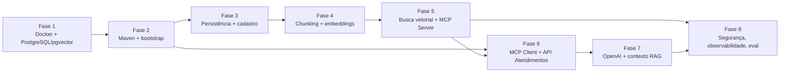

# Plano de implementação do MVP — COTI AI Atendimento

Este plano organiza a construção do MVP definido em [`02-requirements.md`](02-requirements.md), seguindo a arquitetura de [`03-architecture.md`](03-architecture.md) e os contratos de [`06-api-contracts.md`](06-api-contracts.md). As tarefas atômicas estão em [`05-tasks.md`](05-tasks.md).

## 1. Regras do plano

- **Teste junto com o código.** Cada fase entrega os testes do que implementa (AGENTS.md, seção 5). A Fase 8 não é "a fase dos testes": ela consolida o que é transversal (limite de requisições, métricas, eval, checklist de produção).
- **Segurança junto com o endpoint.** Todo endpoint nasce com a autenticação definida no contrato. Nenhuma fase expõe endpoint aberto "para testar depois".
- **Uma fase só começa** quando as tarefas de que ela depende estão concluídas e com `./mvnw verify` passando.
- **Itens (conferir)** de `03-architecture.md` são resolvidos na primeira tarefa que os usa, com o resultado registrado na seção 3 deste plano antes de seguir.
- **Fluxo de cada tarefa:** Spec → Plan → Implement → Test → Review (AGENTS.md, seção 6), com o relatório final da seção 7.
- **Docker Desktop ativo** é pré-requisito das Fases 1 e de todos os testes de integração a partir da Fase 3.

## 2. Visão das fases



| Fase | Serviço | Requisitos | Entrega verificável |
|---|---|---|---|
| 1 | infraestrutura | RNF07, RNF09 | PostgreSQL 18 + pgvector no ar em `localhost:5434`, com papéis |
| 2 | ambos | RNF01–RNF03, RNF05, RNF09 | Dois serviços sobem em 8081/8082 com health, erros padronizados, correlação e OpenAPI |
| 3 | conhecimento | RF01 (caminhos de rejeição), RF11 | Schema migrado; cadastro com 400/401/409/413/422/202; listagem e detalhe |
| 4 | conhecimento | RF01 (caminho feliz), RF02, RF03 | Cadastro completo com chunks e embeddings publicados de forma atômica |
| 5 | conhecimento | RF04, RF05, RF12 | Ferramenta MCP `buscar_conhecimento` e diagnóstico REST devolvendo os mesmos trechos |
| 6 | atendimentos | RF06, RF07, RF10 (parcial) | `perguntar` responde "sem evidência" e 503 de MCP; health `DEGRADADO` |
| 7 | atendimentos | RF08, RF09, RF10 | Resposta gerada com fontes derivadas do MCP, validação de saída e prazo |
| 8 | ambos | RNF01, RNF02, RNF06, RNF08 | Limites, métricas, eval, test plan, checklist e revisão OWASP LLM |

A Fase 6 pode começar logo após a Fase 2 para o que não depende da `api-conhecimento` (domínio, mascaramento, controller), mas só termina depois da Fase 5, porque seus testes de integração precisam do contrato MCP implementado.

## 3. Versões fixadas

Preenchida pelas tarefas T002 e T006 em 2026-10-22, consultando o Docker Hub e o Maven Central (`maven-metadata.xml` e POMs publicados). Itens da fase 2 em diante devem usar estes valores.

| Item | Versão | Fonte conferida |
|---|---|---|
| Spring Boot | **4.1.2** (última 4.1.x estável; 4.2.0-RC1 é pré-lançamento e não é usada) | `repo.maven.apache.org/.../spring-boot-starter-parent/maven-metadata.xml` |
| Spring AI | **2.0.1** (exigida pelo projeto; já existe 2.0.2, não adotada) | `spring-ai-bom` 2.0.1 no Maven Central |
| Compatibilidade Boot × Spring AI | O POM publicado do `spring-ai-starter-mcp-client` 2.0.1 depende de `spring-boot-starter` **4.1.1**. Usamos 4.1.2 (patch seguinte do mesmo minor). Se `./mvnw verify` na T009 acusar incompatibilidade, voltar para 4.1.1 e registrar aqui | POM `spring-ai-starter-mcp-client-2.0.1.pom` |
| Spring Framework / Jackson / JUnit / Flyway | 7.0.10 / Jackson 3.1.7 (`tools.jackson`) / 6.0.3 / 12.4.0, gerenciadas pelo Boot 4.1.2 | `spring-boot-dependencies-4.1.2.pom` |
| springdoc-openapi | **3.1.1** (`springdoc-openapi-starter-webmvc-ui`; a 3.1.0 já subiu para Boot 4.1.0) | `maven-metadata.xml` do springdoc; notas da 3.1.0 |
| ArchUnit | **1.5.1** (`archunit-junit5`) | `maven-metadata.xml` do ArchUnit |
| WireMock | **3.13.2** (`org.wiremock:wiremock`; a 4.0.0 só tem betas) | `maven-metadata.xml` do WireMock. Risco: usa Jackson 2 e o Boot 4 usa Jackson 3; conferir ao introduzir (T050/T056) |
| Testcontainers | **2.0.5**, gerenciada pelo Boot 4.1.2. Artefatos: `org.testcontainers:testcontainers-postgresql` e `testcontainers-junit-jupiter`; classe `org.testcontainers.postgresql.PostgreSQLContainer` (a de `org.testcontainers.containers` é a antiga) | `spring-boot-dependencies-4.1.2.pom`; conteúdo do JAR `testcontainers-postgresql-2.0.5` |
| Pacotes de teste do Boot 4 | `@WebMvcTest` em `org.springframework.boot.webmvc.test.autoconfigure` (módulo `spring-boot-webmvc-test`) | Conteúdo do JAR `spring-boot-webmvc-test-4.1.2` |
| Imagem PostgreSQL | **`pgvector/pgvector:0.8.7-pg18-trixie`** (pgvector 0.8.7, PostgreSQL 18, Debian trixie; publicada em 2026-10-01). A tag `0.8.2-pg18-trixie` citada antes também existe, mas está 5 versões atrás | API do Docker Hub (`/v2/repositories/pgvector/pgvector/tags`) e `docker manifest inspect` |
| Artefato do MCP Client | **`org.springframework.ai:spring-ai-starter-mcp-client`** (transporte Streamable HTTP via `spring-ai-autoconfigure-mcp-client-httpclient`, cliente HTTP do JDK). A variante `-webflux` não é usada | POM do starter 2.0.1 e listagem do Maven Central |
| MCP Server | `org.springframework.ai:spring-ai-starter-mcp-server-webmvc` | Listagem do Maven Central |

### Confirmações do spike T031 (Spring AI 2.0.1, concluído em 2026-10-26)

Cada item foi comprovado por teste contra PostgreSQL real, versionado em `PgVectorStoreComportamentoIT` (falha se uma atualização da biblioteca mudar o comportamento).

| Pergunta | Resultado |
|---|---|
| Tipo da coluna `metadata` | `json` (não `jsonb`). Números continuam números no JSON (`vigenteAte` e `ordem` inteiros). Para alterar um campo sem perder os demais: `jsonb_set(metadata::jsonb, ...)::json` |
| `vectorStore.delete(Filter.Expression)` | Aceita a expressão montada por `FilterExpressionBuilder` (`eq("documentoId", id)`) e apaga só os trechos do documento. A variante com expressão em texto também funciona |
| `add()` com id já existente | Atualiza a linha em vez de duplicar. Com o id determinístico (`IdTrecho`), regravar um lote é idempotente |
| O que vira embedding | Só o texto do trecho; os metadados não entram no vetor |
| Dimensão gravada | 1536, igual à migração V3 |
| Lotes grandes | O `BatchingStrategy` do Spring AI quebra um `add()` grande em várias chamadas ao provedor por limite de tokens |
| Novas tentativas | O Spring Framework 7 traz `org.springframework.core.retry.RetryTemplate` (sem dependência extra). Decisão: `max-retries: 0` no SDK da OpenAI e a política fica no código (`PoliticaNovasTentativas`), só para falha transitória (429, 5xx, 408, erro de E/S), com backoff exponencial e variação aleatória. Descartada a dependência `spring-retry`: o recurso já está no framework |

### Confirmações do spike T037 (Spring AI 2.0.1 e pgvector 0.8.7, concluído em 2026-10-27)

Comprovadas em `ScoreCossenoIT`, com trechos de cosseno exato em relação à pergunta e PostgreSQL real.

| Pergunta | Resultado |
|---|---|
| `Document.getScore()` com `COSINE_DISTANCE` | É a **similaridade de cosseno** (`1 - distância`), igual ao cosseno construído (0,95 → 0,95; 1,0 para a pergunta idêntica). Não é a distância |
| Faixa do score | Sem limiar explícito vale o padrão **0** (`SIMILARITY_THRESHOLD_ACCEPT_ALL`): cosseno negativo nunca volta, então o score devolvido fica em [0, 1], como o contrato exige. O score pode passar de 1 por arredondamento de ponto flutuante; o adaptador limita a 1 |
| `similarityThreshold` | Inclusivo (`score >= limiar`). 0,70 corta 0,65 e mantém 0,75 |
| `gte` sobre inteiro no filtro | Funciona: `vigenteAte >= 20261027` mantém `99991231` (sem vigência) e a data de hoje, e exclui ontem. Composto com `status` e `modeloEmbedding` filtra dentro da consulta |
| Valor com aspas no filtro | Vira constante da expressão; não altera a consulta |
| **HNSW com filtro, limiar e linhas apagadas** | **Risco confirmado.** O índice guarda entradas de linhas apagadas até o `VACUUM` e o filtro e o limiar são aplicados depois do scan do índice (`ef_search` 40). Com o índice forçado (`enable_seqscan = off`) e 400 linhas apagadas, a busca voltou **vazia** com 3 trechos válidos. Com `hnsw.iterative_scan` em `relaxed_order` ou `strict_order` voltaram os 3 |
| Decisão | Toda conexão da aplicação roda `SET hnsw.iterative_scan = strict_order` (`spring.datasource.hikari.connection-init-sql`; `strict_order` mantém a ordem exata). Descartado: `ALTER ROLE ... SET`, que exige privilégio que o papel dono não tem, e `SET LOCAL` em cada busca, que exigiria transação em torno de cada consulta |
| Limite do achado | O scan iterativo reduz a perda, mas o HNSW é aproximado: depois de muita inserção e remoção sem `VACUUM` o grafo degrada. Em produção o autovacuum cuida disso; o script de remoção de documentos deve rodar `VACUUM` ao final. A nota de recuperação só sai do eval da Fase 8 |

**Correção do spike T031 (achada na T053, 2026-10-27).** A linha "O que vira embedding: só o texto do trecho" valia só para o dublê de embeddings dos testes. Com o `OpenAiEmbeddingModel` real o padrão é `MetadataMode.EMBED`: o texto enviado ao provedor leva os metadados (ids, `status`, datas) e, mesmo com `metadata-mode: NONE`, um prefixo `"\n\n"` do formatador padrão. Corrigido de dois modos: `spring.ai.openai.embedding.metadata-mode: NONE` e um `ContentFormatter` por `Document` (`PgVectorRepositorioAdapter.SOMENTE_O_TEXTO`) que devolve só o texto em qualquer modo. Travado por `PgVectorRepositorioAdapterFormatoTest` e, de ponta a ponta, por `ServicosIntegradosIT`. Os trechos já cadastrados antes desta correção (nenhum em produção) teriam de ser reindexados.

### Confirmações do spike T044 (cliente MCP, Spring AI 2.0.1 e MCP Java SDK 2.0.0, 2026-10-27)

| Pergunta | Resultado |
|---|---|
| Artefato | `spring-ai-starter-mcp-client` (traz `spring-ai-autoconfigure-mcp-client-httpclient`, transporte Streamable HTTP pelo cliente HTTP do JDK, sem WebFlux) |
| Como obter o cliente | A autoconfiguração publica um bean `List<McpSyncClient>` (`mcpSyncClients`), um cliente por conexão configurada; não há bean individual. O adaptador recebe a lista e exige exatamente 1 |
| Propriedades | `spring.ai.mcp.client.{name,version,type,initialized,request-timeout,toolcallback.enabled}` e `spring.ai.mcp.client.streamable-http.connections.<nome>.{url,endpoint}` |
| Chamar a ferramenta | `cliente.callTool(new CallToolRequest("buscar_conhecimento", Map.of("pergunta", ..., "limite", 5)))` devolve `CallToolResult` (`isError()`, `structuredContent()`, `content()`) |
| Sem ToolCallback | Com `toolcallback.enabled: false` nenhum `ToolCallbackProvider` é registrado: o modelo não recebe a ferramenta |
| **`initialized` e a subida** | **Com o padrão (`true`) a aplicação NÃO sobe com a api-conhecimento desligada** (`Client failed to initialize by explicit API call`, causa `ConnectException`). Com `initialized: false` ela sobe, a primeira chamada abre a sessão sozinha e, se o servidor está fora, falha em ~200 ms com `RuntimeException` (causa `ConnectException`); quando o servidor volta, a chamada seguinte funciona sem reiniciar o serviço |
| Cabeçalhos | Um bean `McpSyncHttpClientRequestCustomizer` (`customize(HttpRequest.Builder, método, URI, corpo, McpTransportContext)`) é aplicado pela autoconfiguração a toda requisição HTTP e é onde entram `Authorization: Bearer` e `traceparent`. Ele roda em threads do cliente HTTP, **sem o MDC** da requisição original |
| Trace | Um bean `McpClientCustomizer<McpClient.SyncSpec>` define `transportContextProvider(...)`, avaliado na thread que chama `callTool`; ali o trace id do MDC vira `McpTransportContext`, que o customizador de cabeçalhos lê. Como a chamada do adaptador roda em outra thread (para o limite de tempo), o MDC é copiado para ela |
| Exceções do cliente | 401 e 403 → `McpHttpClientTransportAuthorizationException`; timeout do SDK → `ReactiveException` com `TimeoutException`; servidor fora → `RuntimeException` com `ConnectException`; HTTP 500 → `RuntimeException` genérica; sessão perdida (o servidor reiniciou) → `RuntimeException("MCP session with server terminated")` sem tipo próprio |
| **Não interromper o cliente** | Interromper (`Future.cancel(true)`) uma chamada durante a conexão inicial preguiçosa **deixa o cliente travado**: as chamadas seguintes nunca terminam. Timeout do próprio SDK não tem esse efeito. Por isso o adaptador não interrompe a thread; ela termina pelo `request-timeout` do SDK |
| Sessão perdida | Depois de o servidor reiniciar, a primeira chamada falha e o SDK reabre a sessão na seguinte. O adaptador repete qualquer falha de transporte (até 2 vezes), então a mesma pergunta se recupera sozinha |
| Status customizado do Actuator | `management.endpoint.health.status.order=DOWN,OUT_OF_SERVICE,DEGRADADO,UP,UNKNOWN` e `management.endpoint.health.status.http-mapping.DEGRADADO=200` funcionam. O agregador escolhe o pior status pela ordem: um componente `DOWN` derrubaria o serviço, então o `conhecimentoMcp` reporta `DEGRADADO` (e não `DOWN`) quando a base está fora |
| Pacotes de saúde no Boot 4 | `org.springframework.boot.health.contributor.{Health, HealthIndicator, Status}` |

Ainda a conferir em tarefas posteriores (spike T061): detalhes de API do Spring AI listados em `03-architecture.md` §15.

### Confirmações do MCP Server (T040–T042, Spring AI 2.0.1 e MCP Java SDK 2.0.0, 2026-10-27)

| Pergunta | Resultado |
|---|---|
| Artefatos e pacotes | `spring-ai-starter-mcp-server-webmvc` traz `spring-ai-mcp-annotations` (`org.springframework.ai.mcp.annotation.McpTool`, `McpToolParam`) e o SDK `io.modelcontextprotocol.sdk:mcp` 2.0.0 (cliente em `io.modelcontextprotocol.client.*`, esquemas em `io.modelcontextprotocol.spec.McpSchema`) |
| Propriedades | `spring.ai.mcp.server.{name,version,protocol,type,capabilities.*}` e `spring.ai.mcp.server.streamable-http.mcp-endpoint` (padrão `/mcp`) |
| `@McpTool.McpAnnotations` | Aceita `readOnlyHint`, `destructiveHint`, `idempotentHint` e `openWorldHint`; os quatro saem em `tools/list` como no contrato |
| `@McpToolParam` | Só tem `description` e `required`. **Não** gera `minLength`, `maxLength`, `minimum`, `maximum`, `default` nem `additionalProperties: false` no `inputSchema`; `limite` sai com `format: int32` |
| `outputSchema` gerado | Tem `trechos`, `total` e os campos do contrato, com `format: uuid` e `enum` da categoria. Sem `maxItems`, `maxLength`, `minimum`, `maximum`; `similaridade` é `number` (não aceita `null`) e, com `@JsonProperty(required = false)`, deixa de ser obrigatória |
| Exceção em `@McpTool` | `RuntimeException` vira `CallToolResult` com `isError = true`. O texto é **`mensagem + quebra de linha + mensagem da causa raiz`**; sem causa, o JSON saía duplicado. `ErroFerramentaException` leva uma causa de mensagem vazia e o texto fica sendo o JSON do `ErroFerramenta` mais uma quebra de linha |
| Validação do SDK | O servidor valida os argumentos contra o `inputSchema` antes do método: tipo errado ou `pergunta` ausente dá `isError = true` com texto do SDK (sem o valor recebido), **não** o JSON `ErroFerramenta`. Argumento desconhecido é ignorado |
| Cliente de teste | `HttpClientStreamableHttpTransport.builder(url).endpoint("/mcp").requestBuilder(HttpRequest.newBuilder().header("Authorization", "Bearer ...")).build()` e `McpClient.sync(transporte)...build()` + `initialize()` |
| Segurança assíncrona | A resposta MCP é assíncrona (SSE) e o redespacho é autorizado de novo. O filtro Bearer precisa gravar o contexto na requisição (`RequestAttributeSecurityContextRepository`); sem isso o log enchia de `AccessDenied ... response already committed` |

---

## Fase 1 — Infraestrutura Docker e PostgreSQL/pgvector

**Objetivo.** Ter um PostgreSQL 18 com pgvector rodando localmente em Docker, na porta 5434 do host, com os papéis `coti_owner` e `coti_app` e o banco `coti_conhecimento`, sem nenhum segredo no repositório.

**Dependências.** Nenhuma. Requer Docker Desktop.

**Arquivos previstos.**
- `.gitignore` (confirmar `.env`, `target/`, arquivos de IDE)
- `.env.example`
- `docker-compose.yml` (serviço `postgres`)
- `docker/postgres/init/01-roles.sh`
- `README.md` (seção "Ambiente local")

**Classes esperadas.** Nenhuma.

**Critérios de aceite.**
- `docker compose up -d postgres` sobe o container saudável (`healthcheck` com `pg_isready`).
- A porta está ligada a `127.0.0.1:5434`, não a `0.0.0.0`.
- O banco `coti_conhecimento` existe; `coti_owner` é o dono; `coti_app` conecta e não tem privilégio de DDL.
- A extensão `vector` está disponível na versão 0.8.7.
- Senhas vêm do `.env`; `.env` está no `.gitignore`; `.env.example` não tem valores.

**Comandos de validação.**

```bash
docker compose up -d postgres
```

```bash
docker compose ps
```

```bash
docker compose exec postgres psql -U coti_app -d coti_conhecimento -c "SELECT name, default_version FROM pg_available_extensions WHERE name = 'vector';"
```

```bash
git check-ignore .env
```

**Riscos técnicos.**
- Tag da imagem `0.8.7-pg18-trixie` diferente no Docker Hub → conferir antes (T003).
- Scripts de `docker-entrypoint-initdb.d` só rodam com volume vazio → documentar `docker compose down -v` para recriar.
- `.sql` não lê variáveis de ambiente → usar `.sh` com `psql` e variáveis.
- Porta 5434 ocupada na máquina → mensagem clara no README.

---

## Fase 2 — Estrutura Maven e inicialização dos dois microsserviços

**Objetivo.** Criar o monorepo Maven agregador e os dois projetos Spring Boot independentes, subindo em 8081 e 8082, com a base transversal pronta: configuração tipada que falha sem variável obrigatória, correlação, erros Problem Details, segurança negando por padrão, Actuator, logs ECS, OpenAPI, regras de arquitetura e imagens Docker.

**Dependências.** Fase 1 (para o compose completo); T006 (versões fixadas).

**Arquivos previstos.**
- `pom.xml` (agregador), `mvnw`, `mvnw.cmd`, `.mvn/wrapper/`
- `api-conhecimento/pom.xml`, `api-atendimentos/pom.xml`
- `*/src/main/resources/application.yml`, `application-local.yml`
- `*/Dockerfile`
- `docker-compose.yml` (acrescenta as duas APIs)

**Classes esperadas** (em cada serviço, pacote `br.com.coti.conhecimento` ou `br.com.coti.atendimentos`).
- `ApiConhecimentoApplication`, `ApiAtendimentosApplication`
- `infraestrutura.config`: `PropriedadesConhecimento` / `PropriedadesAtendimentos` (`record` + `@Validated`), `OpenApiConfig`
- `infraestrutura.observabilidade`: `CorrelacaoFilter`
- `infraestrutura.seguranca`: `SecurityConfig`, `ApiKeyAuthFilter`, `ComparadorChave` (tempo constante)
- `api.erro`: `ManipuladorErrosRest`, `CodigoErro`, `ProblemaFactory`
- Testes: `ArquiteturaTest` (ArchUnit), `CorrelacaoFilterTest`, `ManipuladorErrosRestTest`, `SecurityConfigTest`, `InicializacaoSemVariavelTest`

**Critérios de aceite.**
- `./mvnw verify` na raiz compila e testa os dois serviços.
- Cada serviço tem parent `spring-boot-starter-parent` e importa `spring-ai-bom:2.0.1`; a raiz só agrega.
- `api-conhecimento` sobe em 8081 e `api-atendimentos` em 8082 com o perfil `local`.
- Sem `OPENAI_API_KEY` (ou outra obrigatória), a subida falha com mensagem que cita o nome da variável.
- `GET /actuator/health` responde `{"status":"UP"}` sem autenticação; `env`, `configprops`, `beans`, `heapdump` não expostos.
- Toda resposta tem `X-Correlation-Id`; erros 404/405/415/500 em `application/problem+json` com `codigo`, `correlacaoId`, `timestamp`, sem stack trace.
- Qualquer rota não pública devolve 401 sem credencial.
- Logs em JSON ECS no console.
- `/v3/api-docs` disponível; Swagger UI só no perfil `local`.
- ArchUnit: `dominio` sem Spring/Spring AI/JDBC/Jackson; `api-atendimentos` sem JDBC, `VectorStore` e `EmbeddingModel`.
- `docker compose up` sobe as três peças; `api-atendimentos` sobe mesmo sem a `api-conhecimento`.

**Comandos de validação.**

```bash
./mvnw verify
```

```bash
docker compose up -d --build
```

```bash
curl -i http://localhost:8081/actuator/health
```

```bash
curl -i http://localhost:8082/actuator/health
```

**Riscos técnicos.**
- Incompatibilidade de patch entre Spring Boot 4.1.x e Spring AI 2.0.1 → T006 confere na nota oficial.
- `spring.ai.model.chat: none` / `spring.ai.model.embedding: none` com nome diferente na 2.0 → testar a subida sem o bean indesejado.
- Autoconfigurações do Spring AI exigindo chave na subida dos testes → testes usam valor falso e dublês; nenhuma chamada real.
- Mudanças de pacote no Spring Boot 4 (`@WebMvcTest`, `@MockitoBean`) → conferir na primeira classe de teste.

---

## Fase 3 — Persistência e ingestão de conhecimento

**Objetivo.** Criar o schema por migração, o repositório da tabela `documento` e o cadastro de conhecimento até a análise de conteúdo (rejeições e retenção em revisão), além da listagem e do detalhe (RF11). O caminho feliz do cadastro (gerar chunks e publicar) é concluído na Fase 4.

**Dependências.** Fase 2.

**Arquivos previstos.**
- `api-conhecimento/src/main/resources/db/migration/V1__extensoes.sql`, `V2__documento.sql`, `V3__vector_store.sql`
- `api-conhecimento/src/test/resources/` (script de papéis para o Testcontainers)

**Classes esperadas.**
- `dominio`: `Documento`, `StatusDocumento` (`PROCESSANDO`, `PUBLICADO`, `EM_REVISAO`, `ERRO_PROCESSAMENTO`), `Categoria`, `Pendencia`, `NormalizadorTexto`, `HashConteudo`; `excecao.ConhecimentoDuplicadoException`, `DadoPessoalDetectadoException`, `ConhecimentoNaoEncontradoException`
- `aplicacao`: `CadastrarConhecimentoService`, `ConsultarConhecimentosService`; `porta.RepositorioDocumentoPort`, `porta.AnalisadorConteudoPort`
- `infraestrutura.persistencia`: `DocumentoJdbcRepositorio`
- `infraestrutura.analise`: `AnalisadorConteudoRegex`, `PadroesAnaliseProperties`
- `api.rest`: `ConhecimentoController`; `api.rest.dto`: `CadastrarConhecimentoRequest`, `ConhecimentoCadastradoResponse`, `ConhecimentoResumo`, `ConhecimentoDetalheResponse`, `PaginaConhecimentosResponse`
- Testes: `PostgresContainerConfig` (Testcontainers compartilhado), `MigracoesIT`, `DocumentoJdbcRepositorioIT`, `NormalizadorTextoTest`, `AnalisadorConteudoRegexTest`, `CadastrarConhecimentoServiceTest`, `ConhecimentoControllerTest`, `ConsultarConhecimentosIT`

**Critérios de aceite.**
- Flyway aplica V1–V3 com `coti_owner`; a aplicação conecta com `coti_app`; `coti_app` não consegue `CREATE TABLE`.
- `vector_store` tem `embedding vector(1536)` e índice HNSW `vector_cosine_ops`.
- `POST /api/conhecimentos`:
  - 401 sem chave; 401 com a chave MCP;
  - 400 para cada regra de Bean Validation e campo desconhecido, sem eco do valor;
  - 413 acima de 256 KB;
  - 409 para conteúdo repetido (mesmo hash após normalização);
  - 422 com CPF válido, e-mail ou telefone, sem gravar nada;
  - 202 `EM_REVISAO` com `pendencias = ["POSSIVEL_PROMPT_INJECTION"]` e `quantidadeChunks = 0`.
- `GET /api/conhecimentos` com filtros e paginação (400 para `tamanho` 101), sem `conteudo`; `GET /api/conhecimentos/{id}` com `conteudo` e `pendencias`; 404 `CONHECIMENTO_NAO_ENCONTRADO`; 400 para id não UUID.
- Nenhum log contém o conteúdo do documento.

**Comandos de validação.**

```bash
./mvnw -pl api-conhecimento verify
```

**Riscos técnicos.**
- Testcontainers precisa criar os mesmos papéis do compose → script de init reutilizado no teste.
- Falsos positivos do analisador (telefone da própria COTI em documento institucional) → padrões configuráveis; a regra de dado pessoal mira dados de pessoas físicas, e a lista inicial é revisada no eval.
- Pacote do `PostgreSQLContainer` na linha 2.x do Testcontainers → conferir.

---

## Fase 4 — Chunking e geração de embeddings

**Objetivo.** Completar o cadastro: dividir o texto com sobreposição, gerar embeddings com `text-embedding-3-small` (1536), gravar no `vector_store` e publicar de forma atômica (ADR-07), com compensação em falha e limpeza na subida.

**Dependências.** Fase 3.

**Arquivos previstos.** Apenas classes e testes; nenhuma migração nova.

**Classes esperadas.**
- `dominio`: `DivisorTexto`, `ConfiguracaoDivisao`, `Trecho`, `IdTrecho` (UUID v5), `VigenciaMetadado` (inteiro `AAAAMMDD`, `99991231`); `excecao.DocumentoGrandeDemaisException`, `ModeloIndisponivelException`
- `aplicacao`: `CadastrarConhecimentoService` (caminho feliz e compensação), `IndexarDocumentoService`, `PublicarDocumentoService`, `PoliticaNovasTentativas` (backoff exponencial com variação), `RecolherDocumentosInterrompidosService`; `porta.RepositorioVetorialPort`
- `infraestrutura.vetorial`: `PgVectorRepositorioAdapter`, `TradutorFalhasEmbedding`; `infraestrutura.persistencia`: `LimpezaDocumentosInterrompidos`; `infraestrutura.config`: `IndexacaoConfig`
- Testes: `DivisorTextoTest`, `IdTrechoTest`, `EmbeddingModelFalso` (`@TestConfiguration`), `PgVectorRepositorioAdapterIT`, `PublicacaoAtomicaIT`, `CadastroCompletoIT`, `LimpezaDocumentosInterrompidosIT`, `PoliticaNovasTentativasTest`

**Critérios de aceite.**
- Divisor: nenhum trecho acima de 1.500; sobreposição de até 200 entre vizinhos; corte em fim de frase quando possível; texto curto em um trecho; mesmos trechos e ids para a mesma entrada; mais de 500 trechos → exceção; `sobreposicao >= tamanhoMaximo` recusado na subida; texto sem espaços não entra em laço.
- Cadastro válido → 201 `PUBLICADO`, `quantidadeChunks > 0`, `modeloEmbedding = text-embedding-3-small`.
- Cada linha do `vector_store` tem `documentoId`, `titulo`, `fonte`, `categoria`, `ordem`, `status`, `modeloEmbedding`, `vigenteAte` (inteiro), `cadastradoEm`.
- Durante a gravação, os chunks ficam `PROCESSANDO`; após a publicação, chunks e documento ficam `PUBLICADO` na mesma transação.
- Falha definitiva no segundo lote → nenhum chunk do documento permanece; documento `ERRO_PROCESSAMENTO`; resposta 503 `MODELO_INDISPONIVEL` com `conhecimentoId`.
- 429 seguido de sucesso → publicado; 401 → sem nova tentativa e com alerta de configuração no log, sem a chave.
- Documento `PROCESSANDO` há mais de 10 minutos é limpo na subida.
- Nenhum teste chama a OpenAI real.

**Comandos de validação.**

```bash
./mvnw -pl api-conhecimento verify
```

```bash
./mvnw -pl api-conhecimento test -Dtest=DivisorTextoTest
```

**Riscos técnicos.**
- Tipo da coluna `metadata` (`json`) e o `jsonb_set` com conversão → validar em `PublicacaoAtomicaIT` (item conferir).
- Assinatura de `vectorStore.delete(Filter.Expression)` na 2.0.1 → conferir.
- O `PgVectorStore` gera embeddings dentro do `add()`; o retry precisa envolver o `add()` do lote inteiro sem duplicar linhas → ids determinísticos tornam a regravação idempotente (conferir comportamento de conflito de id).
- Recursos de retry do Spring Framework 7 → conferir; se não respeitarem o `Prazo`, usar a `PoliticaNovasTentativas` própria.

---

## Fase 5 — Busca vetorial e MCP Server

**Objetivo.** Implementar a busca semântica (RF04) como um único caso de uso, exposto pela ferramenta MCP `buscar_conhecimento` sobre Streamable HTTP (RF05) e pelo endpoint administrativo de diagnóstico (RF12), com autenticação própria para `/mcp`.

**Dependências.** Fase 4.

**Arquivos previstos.** Configuração do MCP Server em `application.yml`.

**Classes esperadas.**
- `dominio`: `TrechoEncontrado`, `LimitesBusca`; `excecao.ArgumentosInvalidosException`, `BaseConhecimentoIndisponivelException`
- `aplicacao`: `BuscarConhecimentoService`
- `api.mcp`: `BuscarConhecimentoTool` (`@McpTool`), `ResultadoBusca`, `TrechoResultado`, `ErroFerramenta`
- `api.rest`: `DiagnosticoBuscaController`; `api.rest.dto`: `BuscaDiagnosticoRequest`, `BuscaDiagnosticoResponse`
- `infraestrutura.seguranca`: cadeia de filtros para `/mcp/**` (Bearer `CONHECIMENTO_MCP_API_KEY`)
- Testes: `BuscarConhecimentoServiceTest`, `BuscaVetorialIT`, `ScoreCossenoIT` (spike), `BuscarConhecimentoToolContratoIT`, `SegurancaMcpIT`, `DiagnosticoBuscaControllerTest`, `DiagnosticoIgualMcpIT`

**Critérios de aceite.**
- Busca aplica dentro da consulta: `PUBLICADO`, modelo atual, `vigenteAte >= hoje`, `topK = limite`, limiar 0,70; ordena por similaridade; corta 2.000 por trecho e 8.000 no total.
- `EM_REVISAO`, `PROCESSANDO`, vencido e modelo diferente nunca aparecem.
- `tools/list` mostra `buscar_conhecimento` com `inputSchema` (`pergunta`, `limite`) e `outputSchema` (`trechos`, `total`) do contrato; anotações `readOnlyHint=true`, `destructiveHint=false`.
- `tools/call` válido → `structuredContent` com `id`, `texto`, `documentoId`, `titulo`, `fonte`, `categoria`, `similaridade`; sem `limite` → no máximo 5.
- Argumentos inválidos → `isError=true` com `ErroFerramenta` `ARGUMENTOS_INVALIDOS`; banco indisponível → `BASE_CONHECIMENTO_INDISPONIVEL`; nada de detalhe interno.
- `/mcp` sem credencial, com chave errada ou com a chave administrativa → HTTP 401.
- Diagnóstico e MCP devolvem os mesmos trechos e similaridades para a mesma pergunta; diagnóstico exige chave administrativa.

**Comandos de validação.**

```bash
./mvnw -pl api-conhecimento verify
```

**Riscos técnicos.**
- Score do `PgVectorStore` com distância cosseno pode não ser `1 - distância` → `ScoreCossenoIT` antes de fixar o limiar.
- HNSW com filtro pode devolver menos de `k` resultados → medir; avaliar `hnsw.iterative_scan` só com evidência.
- `@McpTool` pode não gerar `minLength`/`maximum`/`default` no `inputSchema` → registrar a diferença no teste de contrato; validação em código continua.
- Formato do texto de erro gerado pelo Spring AI a partir da exceção → garantir o JSON `ErroFerramenta` com teste.
- Embedding da pergunta com timeout de 5 s aplicado pela aplicação → testar com `EmbeddingModelFalso` lento.

---

## Fase 6 — MCP Client e API de Atendimentos

**Objetivo.** Implementar a `api-atendimentos` até a busca: receber a pergunta, mascarar dados pessoais, chamar `buscar_conhecimento` de forma determinística, validar o resultado, responder "sem evidência" quando não houver trechos e mapear falhas do MCP para 503. O gerador de resposta é só uma porta nesta fase.

**Dependências.** Fase 2 (início), Fase 5 (conclusão dos testes de integração).

**Arquivos previstos.** Configuração do MCP Client em `application.yml`.

**Classes esperadas.**
- `dominio`: `PerguntaAluno`, `TrechoConhecimento`, `Fonte`, `ResultadoAtendimento`, `Prazo`; `excecao.BaseConhecimentoIndisponivelException`, `TempoEsgotadoException`
- `aplicacao`: `ResponderPerguntaService` (versão sem modelo); `porta.BaseConhecimentoPort`, `porta.GeradorRespostaPort`, `porta.MascaradorPort`
- `infraestrutura.privacidade`: `MascaradorDadosPessoaisRegex`
- `infraestrutura.mcp`: `BaseConhecimentoMcpAdapter`, `McpCabecalhosCustomizer`, `ValidadorResultadoBusca`, `ConhecimentoMcpHealthIndicator`
- `api.rest`: `AtendimentoController`; `api.rest.dto`: `PerguntarRequest`, `RespostaAtendimentoResponse`, `FonteResponse`
- Testes: `PrazoTest`, `MascaradorDadosPessoaisRegexTest`, `ValidadorResultadoBuscaTest`, `ServidorMcpDeTeste` (servidor MCP mínimo em teste), `BaseConhecimentoMcpAdapterIT`, `ResponderPerguntaServiceTest`, `AtendimentoControllerTest`, `HealthDegradadoIT`, `SubidaSemConhecimentoIT`

**Critérios de aceite.**
- `POST /api/atendimentos/perguntar` valida 3–1.000 caracteres e rejeita campos extras (400), sem chamar o MCP.
- CPF, e-mail e telefone mascarados antes do MCP e do log.
- Toda pergunta válida chama `buscar_conhecimento` pelo código, com `Bearer` e `traceparent`; `toolcallback.enabled=false`.
- Resultado fora do schema, `isError=true`, 401/403, timeout (até 2 novas tentativas) → 503 `BASE_CONHECIMENTO_INDISPONIVEL` com `Retry-After`.
- `trechos` vazio → 200 com `conhecimentoSuficiente=false`, `fontes=[]` e mensagem configurada; o gerador não é chamado.
- Health: `api-conhecimento` fora → status agregado `DEGRADADO` com HTTP 200; `liveness` e `readiness` `UP`.
- O serviço sobe com a `api-conhecimento` desligada.
- Prazo total de 30 s interrompe novas tentativas → 503 `TEMPO_ESGOTADO`.

**Comandos de validação.**

```bash
./mvnw -pl api-atendimentos verify
```

**Riscos técnicos.**
- Nome do starter do MCP Client e forma de injetar cabeçalhos no transporte → spike T043.
- `initialized: true` pode fazer a subida falhar sem o servidor → testar; se falhar, inicialização preguiçosa no adaptador.
- Status customizado `DEGRADADO` no Actuator → conferir propriedades `status.order` e `http-mapping`.
- Servidor MCP de teste precisa seguir o mesmo contrato → gerar a partir dos mesmos `record`s de exemplo do contrato, não do código da `api-conhecimento` (os serviços não compartilham código).

---

## Fase 7 — Integração com OpenAI e montagem do contexto RAG

**Objetivo.** Completar o fluxo B: montar o contexto (filtro, sanitização, limites, rótulos `T<n>`), gerar a resposta com o `ChatClient` sem ferramentas e com saída estruturada, validar a saída, derivar as fontes do resultado MCP e tratar todas as falhas do modelo.

**Dependências.** Fase 6.

**Arquivos previstos.**
- `api-atendimentos/src/main/resources/prompts/responder-pergunta.system.v1.st`
- `api-atendimentos/src/main/resources/prompts/responder-pergunta.user.v1.st`

**Classes esperadas.**
- `dominio`: `ContextoRag`, `ReferenciaTrecho`, `RespostaGerada`; `excecao.ModeloIndisponivelException`, `SaidaModeloInvalidaException`
- `aplicacao`: `MontadorContextoRag`, `ValidadorRespostaModelo`, `DerivadorFontes`, `ResponderPerguntaService` (completo)
- `infraestrutura.ia`: `OpenAiGeradorRespostaAdapter`, `RespostaModelo` (`record`), `ChatClientConfig`
- Testes: `MontadorContextoRagTest`, `ValidadorRespostaModeloTest`, `DerivadorFontesTest`, `ResponderPerguntaServiceTest` (completo), `OpenAiGeradorRespostaAdapterIT` (WireMock), `AtendimentoFimAFimIT` (servidor MCP de teste + WireMock), `PromptInjectionIT`

**Critérios de aceite.**
- Montador: descarta abaixo de 0,70; `similaridade` nula vai para o fim; neutraliza `<trechos>`, `</trechos>`, `<trecho`, `</trecho>`, `<pergunta>`, `</pergunta>`; escapa aspas em atributos; 2.000 por trecho, 8.000 no total, máximo 5, remove inteiros os de menor similaridade; rótulos `T1..Tn`.
- `ChatClient` sem ferramentas, temperatura 0, `max-tokens` 600, saída estruturada nativa `RespostaModelo(resposta, conhecimentoSuficiente, referencias)`; modelo vindo de `OPENAI_CHAT_MODEL`.
- Validador reprova: referência inexistente; `conhecimentoSuficiente=true` sem referência; valor monetário, data, horário, número de vagas ou condição comercial ausentes dos trechos referenciados. Até 2 novas tentativas com o motivo; depois, "sem evidência".
- Fontes copiadas do resultado MCP (`id`, `documentoId`, `titulo`, `fonte`, `categoria`, `similaridade`), sem repetição, ordenadas; nada vindo do texto do modelo; rótulos `T<n>` não aparecem na resposta.
- `conhecimentoSuficiente=false` do modelo → mensagem de recusa configurada, `fontes=[]`.
- OpenAI: timeout/429/5xx → 1 nova tentativa e 503 `MODELO_INDISPONIVEL`; 400/401/403 → sem nova tentativa, 503.
- Trecho com instrução maliciosa ou delimitador forjado não altera a estrutura do prompt nem o formato da resposta.
- Resposta não expõe prompt, modelo, tokens nem texto integral dos trechos.

**Comandos de validação.**

```bash
./mvnw -pl api-atendimentos verify
```

**Riscos técnicos.**
- Saída estruturada nativa da OpenAI exige schema estrito; `List<String>` e campos obrigatórios devem gerar schema aceito → validar no WireMock com a forma da requisição.
- Validador de valores/datas por regex pode gerar falso positivo (ex.: "2 anos de experiência") → casos de teste com textos reais da COTI; regra só para padrões monetários, datas, horários, "vagas".
- Identificador do modelo de chat ainda não escolhido → testes usam valor fictício; escolha real na Fase 8 pelo eval.
- Propriedade para desligar o conteúdo de prompt nas observações do Spring AI → conferir.

---

## Fase 8 — Testes, segurança e observabilidade

**Objetivo.** Fechar o que é transversal: limite de requisições, acesso restrito a métricas, métricas de negócio, verificação de logs e trace entre serviços, eval com documentos reais, escolha do modelo de chat, plano de testes, checklist de produção e revisão OWASP LLM.

**Dependências.** Fases 5 e 7.

**Arquivos previstos.**
- `api-conhecimento/eval/recuperacao.jsonl`
- `api-atendimentos/eval/resposta.jsonl`, `api-atendimentos/eval/adversarial.jsonl`
- `specs/07-test-plan.md`, `specs/08-checklist.md`
- `docs/owasp-llm-revisao.md` (ou seção no checklist)
- Configuração do verificador de segredos (após aprovação)
- `scripts/smoke-local.sh`

**Classes esperadas.**
- `infraestrutura.seguranca`: `LimiteRequisicoesFilter`, `BaldeTokens` (nos dois serviços)
- `infraestrutura.observabilidade`: `MetricasAtendimento`, `MetricasConhecimento`
- Testes: `LimiteRequisicoesFilterTest`, `LimiteRequisicoesIT`, `ActuatorAcessoIT`, `MetricasAtendimentoIT`, `LogsSemDadoSensivelIT`, `PropagacaoTraceIT`
- Eval: `ExecutorEvalRecuperacao`, `ExecutorEvalResposta` (`@Tag("eval")`, perfil `eval`)

**Critérios de aceite.**
- 429 com `Retry-After`: `perguntar` 10/min por IP; cadastro 30/min e diagnóstico 10/min por credencial.
- `/actuator/metrics` e `/actuator/prometheus` só com `MONITORAMENTO_API_KEY`; detalhes do health só autenticado.
- Métricas `coti.atendimento.resultado`, `coti.atendimento.etapa.duracao`, `coti.atendimento.saida_reprovada`, `coti.conhecimento.cadastro`, com tags de versão de prompt e modelo.
- Teste de captura de log prova que pergunta, CPF, texto de trecho e chaves não aparecem.
- O `traceparent` enviado pela `api-atendimentos` chega à `api-conhecimento` e o mesmo trace id aparece nos logs das duas.
- Eval com cerca de 20 casos de recuperação, 20 de resposta e 10+ adversariais, vindos de documentos reais da COTI; notas mínimas definidas em `07-test-plan.md`; 100% de recusa para preço, data, horário e vaga inexistentes.
- `OPENAI_CHAT_MODEL` escolhido pelo eval (menor modelo que passa), registrado com versão.
- `07-test-plan.md` com matriz critério de aceite → teste/eval completa; `08-checklist.md` com os itens da seção 11.2 da arquitetura e LGPD.
- Revisão OWASP Top 10 para LLM com evidência por item; nenhum "não atende" sem plano.
- `scripts/smoke-local.sh` cadastra um documento e faz uma pergunta pelo compose, mostrando resposta com fonte.

**Comandos de validação.**

```bash
./mvnw verify
```

```bash
./mvnw -pl api-atendimentos verify -Peval
```

```bash
docker compose up -d --build
```

```bash
bash scripts/smoke-local.sh
```

**Riscos técnicos.**
- **Conteúdo real da COTI**: eval e smoke dependem de documentos oficiais (cursos, modalidades, pré-requisitos). Sem eles, o eval mede material inventado. Precisa ser fornecido pela COTI antes desta fase.
- Eval e smoke usam a OpenAI real → custo e envio de dados: só documentos públicos e perguntas sem dado pessoal até o item LGPD do checklist estar resolvido.
- Limite em memória não vale com várias instâncias → registrado como item pré-rede.
- Verificador de segredos (por exemplo, gitleaks) é ferramenta nova → exige aprovação.

---

## 4. Definição de pronto (vale para toda tarefa)

- Critérios de aceite da tarefa atendidos e cobertos por teste.
- `./mvnw -pl <serviço> verify` executado com Docker ativo e passando; saída real no relatório.
- Nenhuma violação da constituição, do contrato ou das fronteiras entre serviços.
- Nenhum segredo, nenhum log com dado sensível.
- Itens (conferir) usados pela tarefa resolvidos e registrados.
- Relatório da seção 7 do AGENTS.md entregue.
